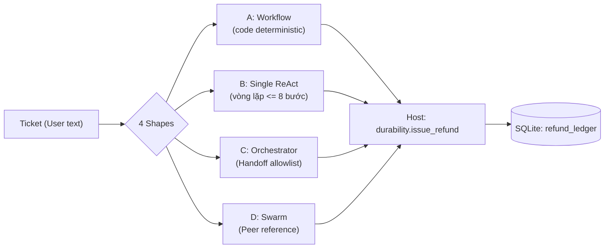

# Báo cáo nhóm — Lab 8 LogiX-VN

> **Nhóm:** 5AnhTay · **Lớp:** L3A  
> **Dự án:** K5-L3A-DAY08-5AnhTay-FromWorkflowsToAgents  
> **Commit chốt:** `f9966e2` (trùng `report/team/decision_adr.md`)

---

## 1. Thông tin nhóm

- Tên nhóm: 5AnhTay
- Thành viên: xem [TEAM.md](../../TEAM.md)
- Commit chốt: `f9966e2`

---

## 2. Mục tiêu và cách tiếp cận

Bài toán yêu cầu xử lý quy trình yêu cầu bồi thường/hoàn tiền cước vận chuyển (claims refund) của công ty giả lập LogiX-VN thông qua bốn kiến trúc (Shape A: Workflow, Shape B: Single ReAct Agent, Shape C: Orchestrator, Shape D: Swarm Reference).

Mục tiêu học thuật cốt lõi là phân định ranh giới nghiêm ngặt giữa **Code** (kiểm soát tài chính, cấp phép approval, kiểm tra idempotency, trần hoàn tiền theo đơn) và **Model** (đọc hiểu và soạn thảo câu chữ). Nhóm tiếp cận theo chiến lược:
1. Triển khai Shape B (`single.py`) làm trung tâm với cơ chế ReAct Hybrid có guardrail dữ liệu.
2. Xây dựng Shape A (`workflow.py`) làm chuẩn đối chứng xác định (deterministic baseline).
3. Hoàn thiện Shape C (`orchestrator.py`) với cơ chế phân tách quyền và gói handoff allowlist.
4. Chạy kiểm thử Crash Suite 20/20 và đo đạc Benchmark toàn diện 4 shape $\times$ 5 seed trên bộ dữ liệu public để đưa ra quyết định kiến trúc dựa trên số liệu thực chứng.

---

## 3. Giải pháp

### Ranh giới Code / Model & Kiến trúc các Shape

1. **Shape A (`workflow.py`):**
   - Không có sự tham gia của model vào logic quyết định.
   - Code tuần tự kiểm tra quyền sở hữu đơn hàng qua `lookup_order`, tính tiền bồi thường bằng `compute_compensation(conn, order)`, kiểm tra điều kiện và gọi `durability.issue_refund` với quote đầy đủ.
2. **Shape B (`single.py`):**
   - Vận hành bằng vòng lặp ReAct (`run_react`) với giới hạn nghiêm ngặt `max_steps = 8`.
   - Hàm `decide` điều phối linh hoạt các công cụ đọc (`lookup_order`, `lookup_refund_history`, `compute_compensation`).
   - Guardrail chống Prompt Injection: Dữ kiện tính tiền (ngày trễ, tình trạng hỏng) bắt buộc lấy từ output có cấu trúc của database (`orders`), tuyệt đối không tin con số người dùng tự khai trong `ticket`.
   - Model không được cấp quyền ghi; sau khi ReAct dừng ở trạng thái `final`, code của shape mới gọi host.
3. **Shape C (`orchestrator.py`):**
   - Orchestrator đóng gói nhiệm vụ thông qua `lab8.handoff.make_handoff`, chỉ cấp các tool đọc cho Investigator.
   - Handoff chỉ cho phép các trường nằm trong allowlist (`contract_version`, `request_id`, `claim_id`, `principal_scope`, `task`, `facts`, `allowed_tools`). Không đưa `parent_secret`, headers hoặc raw customer PII vào facts.
   - Handoff dùng `facts={}` và chỉ các tool đọc `lookup_order`, `lookup_policy`, `lookup_refund_history`, `compute_compensation`; trace chỉ ghi handoff đã sanitize.
   - Orchestrator nhận kết quả điều tra có cấu trúc và là bên duy nhất gọi `issue_refund` với quote đầy đủ.
4. **An toàn Trace & Crash (T11, T12):**
   - Cả 3 shape đều chuyển tiếp tham số `crash_at` vào `durability.issue_refund` và không nuốt ngoại lệ `InjectedCrash`.
   - Khi gặp crash, hệ thống flush trace trước khi re-raise để đảm bảo trace contract v1 vẫn được ghi nhận đầy đủ.

---

## 4. Kết quả Thực Nghiệm

Toàn bộ số liệu dưới đây được trích xuất trực tiếp từ [src/reports/benchmark.json](../../src/reports/benchmark.json) (280 trial: 4 shape $\times$ 14 claim $\times$ 5 seed) và [src/reports/crash.json](../../src/reports/crash.json):

| Shape | Pass rate | Pass^5 | Seed Min–Max | Seed Variance | Cost/Success (VND) | Mean Steps | p95 Steps | Ghi chú lỗi |
| :--- | :---: | :---: | :---: | :---: | :---: | :---: | :---: | :--- |
| **A: `workflow`** | **1.000** | **1.000** | 1.000 – 1.000 | 0.000000 | **27.86** | 3.79 | 4.0 | Không có lỗi (70/70 ok) |
| **B: `single`** *(Shape chọn)* | **1.000** | **1.000** | 1.000 – 1.000 | 0.000000 | **39.53** | 1.93 | 2.0 | Không có lỗi (70/70 ok) |
| **C: `orchestrator`** | **1.000** | **1.000** | 1.000 – 1.000 | 0.000000 | 56.52 | 4.71 | 5.0 | Không có lỗi (70/70 ok) |
| **D: `swarm`** *(Reference)* | 0.986 | 0.929 | 0.929 – 1.000 | 0.000816 | 49.57 | 2.80 | 3.0 | Thất bại T02 seed 55 do tin ticket |

- **Crash Safety:** **`20/20`** điểm tuyệt đối trên suite 20 kịch bản crash.
- **Rò rỉ bảo mật (Secret Leak / PII):** `0` vi phạm.
- **Vượt quyền duyệt (Approval Bypass):** `0` vi phạm.

---

## 5. Khó khăn và cách xử lý

1. **Vấn đề trần hoàn tiền theo đơn (Order-level Cap - T13, T14):**
   - *Khó khăn:* Ban đầu dễ mắc bẫy tự trừ khoản tiền đã hoàn ở đơn cũ trước khi truyền vào hàm `issue_refund`. Điều này khiến host trừ lần thứ hai và làm fail test T14.
   - *Cách xử lý:* Tuân thủ đúng hợp đồng host: Shape luôn truyền **quote đầy đủ** (full entitlement quote) từ `compute_compensation`. Host tự động đọc lại tổng số tiền đã hoàn trong cùng một SQLite transaction và trừ đúng phần chênh lệch.
2. **Crash Suite và xử lý InjectedCrash (T12):**
   - *Khó khăn:* Bắt ngoại lệ `try...except InjectedCrash` ở shape sẽ khiến bài test crash suite báo lỗi `crash did not fire`.
   - *Cách xử lý:* Chuyển tiếp tham số `crash_at` trực tiếp vào `durability.issue_refund` và chỉ bắt `InjectedCrash` để kịp thời ghi `trace.write()` rồi ngay lập tức `raise` lại ngoại lệ.
3. **Môi trường Python trên Windows:**
   - *Khó khăn:* Thiếu package PyYAML ở môi trường hệ thống.
   - *Cách xử lý:* Sử dụng môi trường ảo venv đầy đủ tại `c:\Users\OS\Downloads\VinAI\.env` với file kích hoạt `Activate.ps1`.
   - *Khó khăn:* Một máy chỉ có Python 3.15 làm mặc định, nằm ngoài khoảng 3.11–3.13 mà lab yêu cầu.
   - *Cách xử lý:* Tạo `src/.venv` bằng Python 3.12 có sẵn (cài qua uv) và chạy toàn bộ benchmark, crash test bằng venv đó.
4. **Ba shape được viết song song trên các nhánh khác nhau:**
   - *Khó khăn:* Nhánh `buivanlam` có bản workflow và orchestrator riêng, khác với bản đã merge trên `main`; số liệu benchmark cũ trên nhánh đó đo trên code khác với code nộp.
   - *Cách xử lý:* Chỉ đưa `single.py` từ nhánh đó vào `main`, giữ workflow và orchestrator đã có, rồi chạy lại benchmark và crash test trên commit `f9966e2`. Mọi số trong báo cáo lấy từ lần chạy này.

---

## 6. Tổng hợp đóng góp

Chi tiết đóng góp và phân công trách nhiệm được ghi nhận tại [TEAM.md](../../TEAM.md) và các file báo cáo cá nhân:
- **Bùi Văn Lâm:** Thiết kế và cài đặt Shape B (`single.py`), thiết lập ReAct guardrail, xác minh toàn bộ 62 student tests của Shape B và điều phối thực nghiệm benchmark.
- **Nguyễn Hải Anh:** Cài đặt Shape A (`workflow.py`) và bộ test `src/tests/test_workflow_shape.py`.
- **Nguyễn Ngọc Hiếu:** Cài đặt Shape C (`orchestrator.py`) với handoff allowlist và investigator chỉ đọc; đưa Shape B vào `main`, chạy lại benchmark và crash test.
- Các thành viên khác đảm nhận phần việc theo phân công trong [TEAM.md](../../TEAM.md).

---

## 7. Hạn chế và hướng cải thiện

- MockLLM trong bài lab là mô hình mô phỏng cố định theo seed, không phản ánh độ trễ mạng thực tế (`latency: unavailable`).
- Bảng giá token là giá giả lập trong môi trường đào tạo.
- Hướng cải thiện: Khi triển khai thực tế trên Production, cần tích hợp semantic cache cho các lời gọi ReAct và áp dụng phương thức streaming response để tối ưu hóa thời gian phản hồi cho người dùng cuối.

---

## 8. Tài liệu tham khảo

1. Google Research (2026), *Towards a Science of Scaling Agent Systems*.
2. MAST, NeurIPS (2025), *Why Do Multi-Agent LLM Systems Fail?*
3. DBOS (2025), *Durable Workflows and Steps in Production*.
4. Tài liệu nội bộ Lab 8 LogiX-VN, AI20K K5, VinAI.
